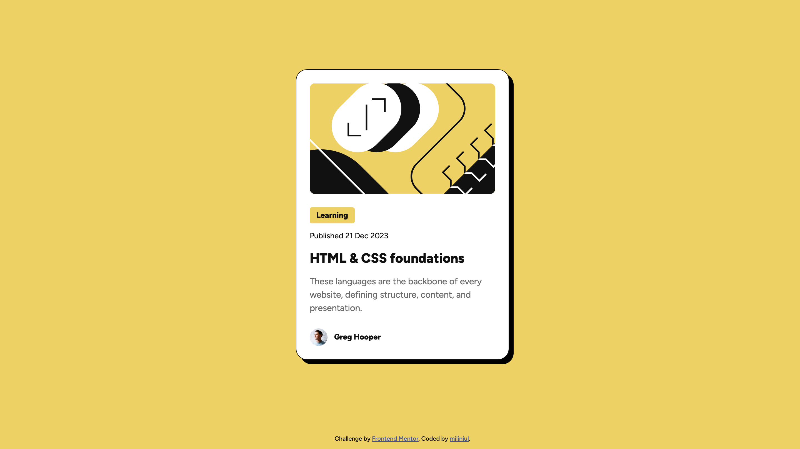

# Frontend Mentor - Blog preview card solution

This is a solution to the [Blog preview card challenge on Frontend Mentor](https://www.frontendmentor.io/challenges/blog-preview-card-ckPaj01IcS). Frontend Mentor challenges help you improve your coding skills by building realistic projects. 

## Table of contents

- [Overview](#overview)
  - [The challenge](#the-challenge)
  - [Screenshot](#screenshot)
  - [Links](#links)
- [My process](#my-process)
  - [Built with](#built-with)
  - [What I learned](#what-i-learned)
  - [Continued development](#continued-development)
  - [Useful resources](#useful-resources)
  - [AI Collaboration](#ai-collaboration)
- [Author](#author)

## Overview

### The challenge

The card title is an interactive link. Its text changes from black to yellow on hover and when focused using keyboard navigation, providing visual feedback for both mouse and keyboard users.

### Screenshot

### Links

- Solution URL: [Blog preview](https://miliniul.github.io/Blog-preview/)

## My process

### Built with

- Semantic HTML5 markup
- CSS custom properties
- Flexbox
- Mobile-first workflow

### What I learned

I learned how to use Flexbox to organize the card's layout. I arranged the image, text content, and author section vertically using `flex-direction: column` and a `24px` gap. Inside the author section, I used `display: flex` and `align-items: center` to align the avatar with the author's name. This helped me control spacing and alignment without adding individual margins to every element.

I also practiced a mobile-first workflow by writing the mobile styles first, then adding a media query for screens at least `640px` wide. On larger screens, I increased the card's width from `327px` to `384px` and adjusted the font sizes. Using `min()` together with `calc(100% - 2rem)` allowed the card to shrink on narrow screens while leaving space on both sides.

### Continued development

In future projects, I want to deepen my understanding of HTML and CSS, with a focus on semantic HTML, responsive design, and building layouts with Grid and Flexbox. I also want to become more confident in managing spacing and choosing the right layout approach for each task.

My next step is to start learning JavaScript so I can add interactivity to my pages. I plan to begin with the fundamentals, then practice working with the DOM and handling user events.

I also want to improve accessibility and write cleaner, more organized code as I build new projects.

### Useful resources

- [Doka](https://doka.guide/) — A community-driven resource in Russian with clear explanations and practical examples of HTML, CSS, and JavaScript. Useful for understanding layout techniques and reviewing the basics.
- [MDN Web Docs](https://developer.mozilla.org/en-US/) — Comprehensive documentation and guides for web technologies. A helpful reference for checking syntax, exploring CSS properties, and learning JavaScript.

### AI Collaboration

I used Perplexity to find learning resources and explore HTML and CSS concepts while working on this project. It helped me understand Flexbox, how to add custom fonts, and how to manage spacing between elements.

I used it as a learning aid, testing the suggestions in my project to better understand how they worked.

## Author

- Frontend Mentor - [@miliniul](https://www.frontendmentor.io/profile/miliniul)
